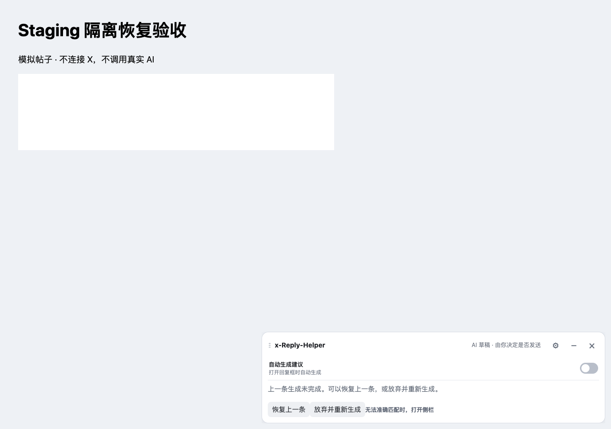
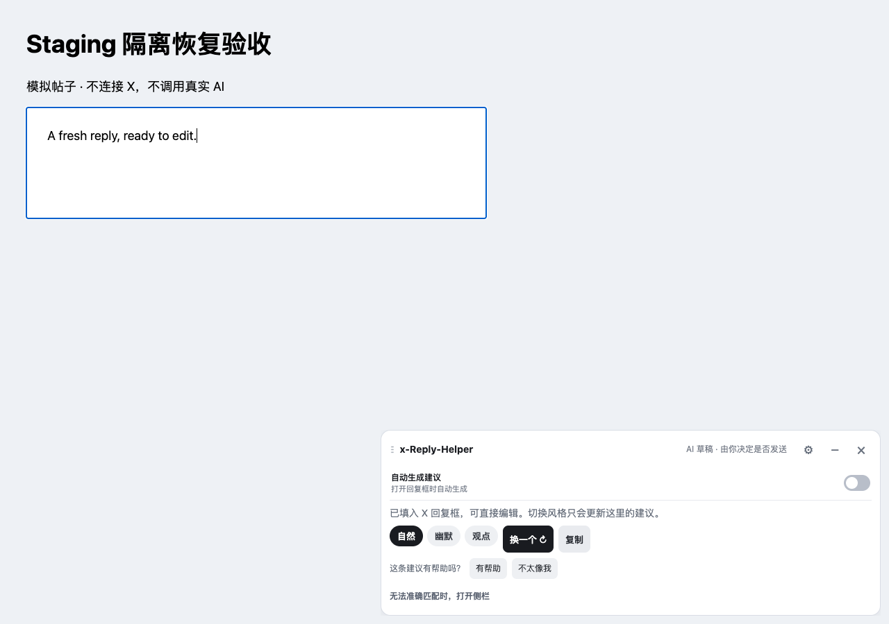

# Staging generation recovery (PR #16)

## Baseline and root cause

Based on PR #16 `454b09898ec296c1e18427a8958635c3462134b5`, on the actual
Staging source `b37b835981bfa911196a21ecb16dafc954802e29`. Preserve SiliconFlow
China/Global, existing model and all account/payment behavior.

Two independent blockers existed: quota reservations serialize unfinished
provider work per account; the extension persisted/replayed `pendingAiDelivery`
without an explicit safe abandonment protocol. A 30-second client timeout is
not evidence of completion of a provider with a configured 60-second timeout.
The existing 10-minute cleanup remains a last resort, enabled for Staging by the
original PR. It is not the interactive recovery mechanism.

## Protocol and safety

- `GET /v1/ai/requests/{requestId}`: read-only own-request state; ready/delivered
  results remain recoverable within the original replay window.
- `GET /v1/ai/requests/active`: read-only own-account pending lookup after lost
  extension storage, restart or a different device's account-level blocker.
- `POST /v1/ai/requests/{requestId}/abandon`: authenticated extension only.
  Existing ready output wins over abandonment. Otherwise atomically claim a
  no-result, unconsumed reserved/uncertain request using the unique existing
  `budget_finalization_ref`, release only credit reservations (not balances),
  retain the full unknown-provider cost estimate, insert a zero-delta release
  ledger and provider-attributed estimated usage. Existing account/batch/budget
  assertions roll the entire transaction back on financial inconsistencies.
- A missing request receives a terminal tombstone: a delayed HTTP envelope
  cannot start that request after local recovery. Existing successful rows and
  outputs are never deleted or overwritten.
- Completion that loses to abandonment returns `GENERATION_ABANDONED` without
  raw output. Late ACK cannot debit a released allocation. If completion wins,
  the original result is recovered and ACK remains idempotent.
- Recovery reads are limited to 60/min/account; abandoning live/missing work to
  2/min and 6/hour/account. Terminal replays do not create another release or
  spend. Shared daily AI budget, normal generation rate limits and single
  provider execution admission remain in force. No automatic paid retry.
- No schema change/migration. Existing status, allocation, claim, audit/usage,
  ledger and rate-limit tables suffice. Do not execute remote SQL or backfill.

## Client behavior

Both the inline assistant and side panel offer **恢复上一条 / 放弃并重新生成** after an uncertain timeout. Inline abandonment requires trusted browser input; scripted page clicks are ignored. A new
requestId is created only after a conclusive server release. Status checks do
not invoke the model. Ready results are validated and ACKed before exposure.
A recovered result from another post is copy-only and cannot auto-fill the new
composer. Original composer association, request isolation and draft guards
remain intact. No publishing action exists in this flow.

The coordinator persists the exact pending envelope in trusted extension local
storage, tolerates a cleanup write failure via memory plus server reconciliation,
and discovers server-side orphans if storage is lost. Ordinary account requests
are bounded at 10 seconds; status and recovery ACK at 8 seconds. Generation keeps
the existing 30-second transport deadline, with a 35-second local queue guard.
A timed-out queued action cannot later start an unseen new provider request.
These deadlines detach UI waiting; they do not declare server completion.
A last-credit reservation still exposes recovery controls rather than hiding
all actions behind the zero-available-credit label.

## Verification evidence

All model traffic is synthetic. Isolated SQLite uses the complete real D1 schema
and transaction wrapper; browser tests bridge real coordinator, HostedAIClient,
recovery routes, quota and ACK logic to local D1. The first provider never
resolves; clicking abandon in the real inline UI lets the second request finish
and records exactly one generation debit. Estimated abandoned cost remains.

Other regressions cover 30s versus 60s ambiguity, missing-request tombstones,
explicit uncertain states, model failure, ready output and lost ACK, repeated
abandon, concurrent completion and scheduled cleanup, free/paid reservations,
last credit, exhausted budget, ledger/budget corruption rollback, other-account
isolation, restart with and without local state, late client results, storage
cleanup failure, replay and timed-out queues. Existing generation, draft,
payment/refund, provider and budget safety regressions must remain green.

This is not a real-X acceptance result. The user performs the final Staging/X
check. No real model calls, online D1 SQL, user balance edits, Production changes,
Pages deployment or Chrome Store submission are authorized in this phase.

## Extension identity and operator acceptance

The currently installed unpacked Staging manifest has no RSA `key`. Its ID is
path-derived: SHA-256 of the existing UTF-8 absolute path produces
`kaaehkpihjenlhjjfjcopkjhegmfmchk`. Do not generate another key or load the new
candidate from a different path and claim the same ID. Back up then replace only
`/Users/xuyaoyang/x posst/apps/reply-copilot/dist/staging` and reload that existing
extension; never uninstall or clear storage. The candidate uses only Staging
API/site and no debugger permission/call. A separate ZIP, installer and rollback
are provided without automatically replacing the current installation.

After reload and refreshing X, verify normal generation, an uncertain request's
restore/abandon actions, a second post after recovery, existing draft protection
and editability. Do not intentionally publish a test comment. Real test calls
and account-level checks remain the user's actions, not automated paid testing.

## Rollback

Before release, capture actual live configuration. Expected prior version:
`1bab0bca-c151-43d9-a3af-00eff98edcad` (source `b37b835`). Deploy only the Worker
using a live-derived keep-vars configuration; compare all 42 bindings, runtime,
Cron and flags before activating 100%. Pages and installed extension stay intact.

If release checks fail, redeploy that old Worker version at 100% and restore the
backed-up extension files at the same path. No D1 restore or table deletion.
Completed releases/cost estimates stay as valid terminal business records; a
code rollback cannot undo them. Existing in-progress requests then follow the
old fallback behavior. Production still has the previous client's transient
blocking risk; promote only after user Staging acceptance and separate approval,
coordinating backend and extension availability while retaining old-client API
compatibility.

## Release gate

Final local run: **787/787 passed**, 0 skipped/failed. API/Web TypeScript,
Worker build and versions-upload dry-run passed. Staging configuration was
read from Cloudflare, not the stale repository defaults; the pre-upload
comparison still matched all 42 bindings and the previous live version.
The independent Staging bundle is 0.3.2 with no debugger permission/API call;
its origin/identity audit and upload receipts are recorded in the PR release
comment. The installed Staging extension is not overwritten automatically.
